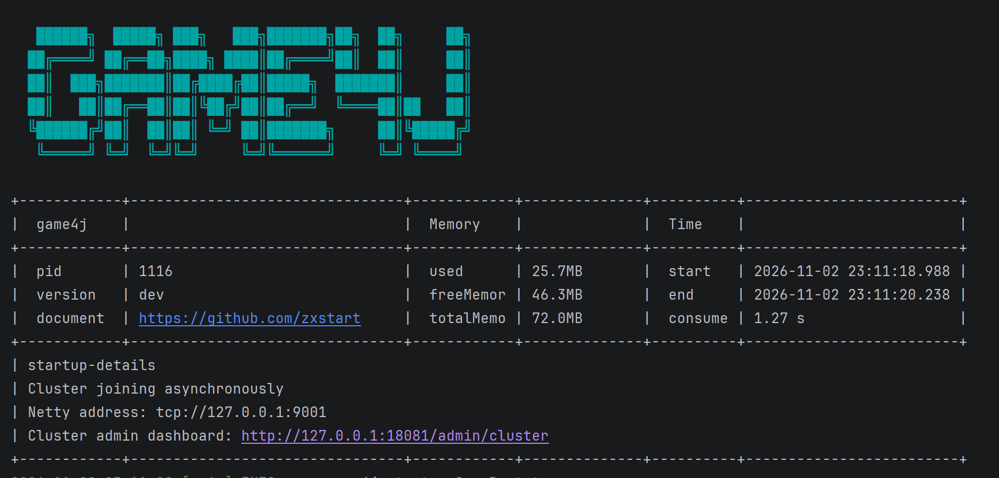
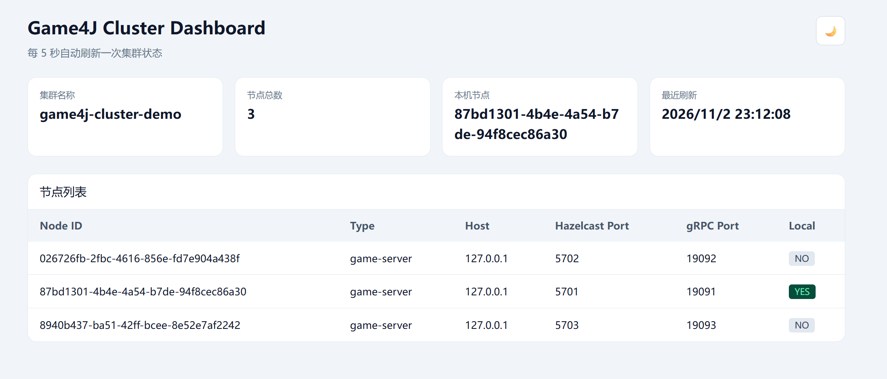

# Game4j

Game4j 是一个基于 Java 和 Netty 的游戏服务器框架，提供消息路由、Protobuf 编解码、集群管理和插件机制。业务代码可以像编写 Spring Boot 控制器一样，通过注解声明控制器、消息指令和请求体，专注于游戏业务逻辑。

## 为什么选择 Game4j？

- **启动快，尽早接受连接**：优先初始化控制器并启动 Netty，集群加入在后台进行，减少等待集群初始化对游戏端口监听的影响。可通过控制器索引减少运行时扫描，进一步优化启动过程。
- **关注内存开销**：支持独立 Java 应用启动；也可使用集群 `client` 模式连接独立的 Hazelcast 控制面，避免每个游戏节点都成为分区成员。
- **业务开发直观**：通过 `@G4JController`、`@G4JRoute` 和 `@G4JRequestBody` 声明消息处理逻辑，用熟悉的控制器方式组织游戏业务。
- **游戏通信开箱可用**：基于 Netty 提供连接与会话管理，结合指令路由、Protobuf 编解码和封包，减少重复的通信代码。
- **集群与运维可见**：支持节点发现、元数据管理和 Gossip 通信，内置集群管理界面，方便查看节点状态。
- **按需扩展**：提供插件机制，支持通过 Java SPI 注册插件；既可独立运行，也提供 Spring 集成。

### 启动表现示例



上图是一次启动截图：启动日志显示耗时 **1.27 秒**，打印时 JVM 已使用堆约 **25.7 MiB**、已分配堆约 **72.0 MiB**。此时 Netty 已开始监听，集群仍在异步加入；该耗时并不代表集群完全就绪的时间。内存数字是 JVM 堆的瞬时值，不是进程总内存占用。实际结果会随机器、JDK、配置和业务负载变化；启动阶段指标与测量方式见[启动优化说明](docs/startup-optimization.md)。

## 环境要求

- JDK 25
- Maven 3

## Quick Start

### 1. 添加依赖

先在 Game4j 仓库根目录执行 `mvn clean install`，将当前 `1.0-SNAPSHOT` 安装到本地 Maven 仓库。然后在自己的项目中添加：

```xml
<dependency>
    <groupId>com.game4j</groupId>
    <artifactId>game4j-starter</artifactId>
    <version>1.0-SNAPSHOT</version>
</dependency>
```

项目需使用 JDK 25 编译。以下示例参考 `game4j-demo`，以独立 Java 应用启动 Game4j。

### 2. 创建启动类

```java
package com.game4j.demo;

import com.game4j.starter.GameBootstrap;
import com.game4j.starter.spring.EnableGame4j;

@EnableGame4j
public class DemoApplication {
    public static void main(String[] args) {
        GameBootstrap.run(DemoApplication.class);
    }
}
```

默认从启动类所在包扫描控制器，也可通过 `@EnableGame4j(scanBasePackage = "...")` 指定扫描范围。

### 3. 编写消息和控制器

分别创建请求、响应类，使用 JProtobuf 注解定义消息字段：

```java
package com.game4j.demo;

import com.baidu.bjf.remoting.protobuf.annotation.Protobuf;

public class LoginRequest {
    @Protobuf(order = 1)
    public String username;
}
```

```java
package com.game4j.demo;

import com.baidu.bjf.remoting.protobuf.annotation.Protobuf;

public class LoginResponse {
    @Protobuf(order = 1)
    public int code;
}
```

像声明控制器方法一样处理游戏消息：

```java
package com.game4j.demo;

import com.game4j.core.annotation.G4JController;
import com.game4j.core.annotation.G4JRequestBody;
import com.game4j.core.annotation.G4JRoute;
import com.game4j.netty.session.Session;

@G4JController
public class DemoController {
    @G4JRoute(cmd = 1001)
    public void login(Session session, @G4JRequestBody LoginRequest request) {
        System.out.println("收到登录请求: " + request.username);

        LoginResponse response = new LoginResponse();
        response.code = 200;
        session.send(1002, response);
    }
}
```

- `@G4JController` 声明游戏消息控制器。
- `@G4JRoute(cmd = 1001)` 将指令号 `1001` 路由到该方法。
- `@G4JRequestBody` 将请求消息体解码为参数对象；`Session` 用于向客户端发送响应。上例以 `1002` 为响应指令号，框架负责 Protobuf 编码和封包。

### 4. 运行仓库内示例

如果想先体验完整的服务端和客户端，在 Game4j 仓库根目录执行：

```shell
mvn clean package
java -jar examples/game4j-plugin-example/target/game4j-plugin-example-1.0-SNAPSHOT.jar
```

在另一个终端运行客户端：

```shell
java -cp examples/game4j-plugin-example/target/game4j-plugin-example-1.0-SNAPSHOT.jar com.game4j.demo.DemoClient alice
```

示例服务默认监听 `19000`，客户端每 5 秒发送登录请求。更多说明见[插件示例](examples/game4j-plugin-example/README.md)。

## 集群与管理界面



管理界面展示集群名称、节点总数、本机节点和节点列表，每 5 秒自动刷新。列表中的 `Local` 标识当前管理界面所属的节点。

默认 `member` 模式下，每个游戏服务器都是 Hazelcast 成员，使用相同的集群名称和种子成员地址加入集群，节点元数据存放在 Hazelcast 分布式 Map 中，并通过 gRPC Gossip 在节点间交换。游戏端口先开始监听，集群在后台加入；如果加入失败，游戏服务仍在本地监听，启动状态会变为 `DEGRADED`。也支持连接独立 Hazelcast 控制面的 `client` 模式，见[部署说明](docs/startup-optimization.md)。

### 本机运行三个节点

以下以仓库内可执行示例为基础。在仓库根目录先执行 `mvn clean package`，然后在 **三个独立终端**分别运行以下命令。示例默认关闭集群和管理界面，因此命令显式启用它们；系统属性会覆盖配置文件。每个节点使用相同的集群名称和完整种子列表，但四种端口各不相同。

```powershell
# 节点 1
java '-Dgame4j.cluster.enabled=true' '-Dgame4j.admin.enabled=true' '-Dgame4j.plugin.cluster-dashboard.enabled=true' '-Dgame4j.cluster.name=game4j-cluster-demo' '-Dgame4j.cluster.seed-members=127.0.0.1:5701,127.0.0.1:5702,127.0.0.1:5703' '-Dgame4j.server.port=9001' '-Dgame4j.cluster.hazelcast-port=5701' '-Dgame4j.cluster.grpc-port=19091' '-Dgame4j.admin.port=18081' -jar examples/game4j-plugin-example/target/game4j-plugin-example-1.0-SNAPSHOT.jar
```

```powershell
# 节点 2
java '-Dgame4j.cluster.enabled=true' '-Dgame4j.admin.enabled=true' '-Dgame4j.plugin.cluster-dashboard.enabled=true' '-Dgame4j.cluster.name=game4j-cluster-demo' '-Dgame4j.cluster.seed-members=127.0.0.1:5701,127.0.0.1:5702,127.0.0.1:5703' '-Dgame4j.server.port=9002' '-Dgame4j.cluster.hazelcast-port=5702' '-Dgame4j.cluster.grpc-port=19092' '-Dgame4j.admin.port=18082' -jar examples/game4j-plugin-example/target/game4j-plugin-example-1.0-SNAPSHOT.jar
```

```powershell
# 节点 3
java '-Dgame4j.cluster.enabled=true' '-Dgame4j.admin.enabled=true' '-Dgame4j.plugin.cluster-dashboard.enabled=true' '-Dgame4j.cluster.name=game4j-cluster-demo' '-Dgame4j.cluster.seed-members=127.0.0.1:5701,127.0.0.1:5702,127.0.0.1:5703' '-Dgame4j.server.port=9003' '-Dgame4j.cluster.hazelcast-port=5703' '-Dgame4j.cluster.grpc-port=19093' '-Dgame4j.admin.port=18083' -jar examples/game4j-plugin-example/target/game4j-plugin-example-1.0-SNAPSHOT.jar
```

| 参数 | 作用 | 节点 3 示例 |
| --- | --- | --- |
| `game4j.server.port` | 客户端连接的游戏服务端口 | `9003` |
| `game4j.cluster.hazelcast-port` | Hazelcast 成员端口 | `5703` |
| `game4j.cluster.grpc-port` | 节点间 Gossip gRPC 端口 | `19093` |
| `game4j.admin.port` | 管理界面 HTTP 端口 | `18083` |

等待节点加入后访问 [http://127.0.0.1:18081/admin/cluster](http://127.0.0.1:18081/admin/cluster)，也可通过 `18082` 或 `18083` 查看其他节点的界面。节点 ID 未配置时自动生成 UUID。上例使用本机地址；跨机器部署时需要将节点地址和种子列表改为彼此可访问的地址，并保证相应端口连通。

## 模块

- `game4j-core`：控制器、路由和上下文。
- `game4j-processor`：控制器索引注解处理器。
- `game4j-protocol`：消息协议。
- `game4j-netty`：Netty 服务、编解码和会话。
- `game4j-cluster`：集群管理。
- `game4j-plugin`：插件机制和集群管理控制台。
- `game4j-starter`：启动与配置。
- `examples/game4j-plugin-example`：插件与客户端示例。

默认配置见 [game4j.properties](game4j-starter/src/main/resources/game4j.properties)，更多部署说明见 [docs](docs/)。

## 许可证

本项目使用 [Apache License 2.0](LICENSE)。
